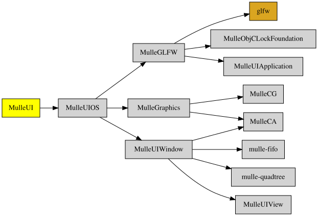

# MulleUICore

#### 🌀 UI for mulle-objc - Desktop and Mobile

# MulleUICore

** TODO: move the code to other places use the name MulleUICore to comprise
** MulleUIImage, MulleUIVideo and MulleUIFoundation
**

#### 🌀 Fundamental UI for mulle-objc - Desktop and Mobile

This library adds some convenience atop of MulleUIOS. It is the main starting
point for developing MulleUICore code without widgets and without the Foundation
(which introduces NSString).

With MulleUICore you can

* create windows with **UIWindow**
* layout window contents with **UIView**
* handle events as an **UIEvent** in your UIView
* do drawings in your UIView with **CALayer**
* animate your UIView or CALayer with **CAAnimation**

MulleUICore will utilize a platform specific drawing library variant of **nanovg**.


| Release Version                                       | Release Notes  | AI Documentation
|-------------------------------------------------------|----------------|---------------
|  [](//github.com/MulleUICore/MulleUICore/actions) | [RELEASENOTES](RELEASENOTES.md) | [DeepWiki for MulleUICore](https://deepwiki.com/MulleUICore/MulleUICore)


At the lowest level, MulleUICore relies on an external library like GLFW or SDL2 to
interface with the operating system and provide a graphics context. This
context could be OpenGL, Vulkan, Metal, or DirectX depending on platform support.

GLFW and SDL2 take care of creating a window, handling input events, and making
the GPU accessible via a graphics API. They provide cross-platform abstractions
over the OS-specific implementations.

On top of the graphics context, MulleUICore uses the nanovg library to provide 2D
vector graphics rendering. Nanovg offers functions like shapes, text, images
etc that it renders using the underlying OpenGL/Vulkan context provided by
GLFW/SDL2.

Nanovg serves as a hardware-accelerated scene graph and renderer optimized for
UI elements. It takes drawing commands from the app and efficiently batches
them into GPU textures and vertices for improved performance.

At the top level, MulleUICore has the UIView class which provides the window and
view hierarchy. During rendering, this UIView hierarchy is flattened into an
array of CALayers.

The CALayer class wraps the underlying nanovg drawing API to provide
CoreAnimation-style rendering. The array of CALayers is passed to nanovg to
issue the actual draw commands.


### An event flow

The operating system detects a mouse button press event and calls the mouse
button callback function registered by the UIEvent class.

Inside this callback, the UIEvent class creates a new UIMouseButtonEvent object
and  initializes it with details like the mouse position, button pressed, and
modifier keys state. This event is then passed to the UIWindow.

The UIWindow then calls its own receiveRetainedEvent: method, passing the new
UIMouseButtonEvent object. This kicks off the event handling and propagation process.

Inside receiveRetainedEvent:, the UIWindow checks if the event target is
itself or if it should be propagated down to a subview.events like window resize.
For a mouse click, the UIWindow will likely return NO from willHandleEvent:
indicating the event should be passed down the view hierarchy.

The UIWindow iterates through its subviews recursively calling
hitTest:withEvent: to find the deepest UIView that contains the mouse click
location. This hit testing uses pointInside:withEvent: to check each view's
bounds.

Let's say a UIButton deep in the hierarchy returns YES from
pointInside:withEvent:, indicating it should handle the mouse click.
The UIWindow sets that UIButton as the event's target.

Now propagateEvent: is called on the UIButton, passing the UIMouseButtonEvent.
This in turn calls handleEvent: on the UIButton.

In its handleEvent: method, the UIButton can update its own state in response
to the mouse click, like changing from an unchecked to checked appearance.

The UIButton calls setNeedsDisplay on itself to mark that its visual appearance needs updating.

On the next frame, the UIWindow traverses its subview hierarchy and calls
-layout on views marked as needing layout. This recalculates frames etc.

The UIWindow then calls renderInContext: on each subview. The UIButton renders
its updated state into its backing CALayer.

Each UIView's CALayers are added to the render queue. The UIWindow walks this
queue and calls -drawInContext: on each CALayer.

The CALayers issue nanovg draw commands to recreate the framebuffer, which will
now contain the updated UIButton state.

Finally, the new framebuffer is swapped with the previous one. The user now
sees the UIButton's changed state.


### You are here




## Add

Use [mulle-sde](//github.com/mulle-sde) to add MulleUICore to your project:

``` sh
mulle-sde add github:MulleUICore/MulleUICore
```

To only add the sources of MulleUICore with dependency
sources use [clib](https://github.com/clibs/clib):


``` sh
clib install --out src/MulleUICore MulleUICore/MulleUICore
```

Add `-isystem src/MulleUICore` to your `CFLAGS` and compile all the sources that were downloaded with your project.


## Install

Use [mulle-sde](//github.com/mulle-sde) to build and install MulleUICore and all dependencies:

``` sh
mulle-sde install --prefix /usr/local \
   https://github.com/MulleUICore/MulleUICore/archive/latest.tar.gz
```

### Legacy Installation

Install the requirements:

| Requirements                                 | Description
|----------------------------------------------|-----------------------
| [MulleUIWindow](https://github.com/MulleUICore/MulleUIWindow)             | 🛸 MulleUIWindow provides UIWindow and extends UIView functionality
| [MulleGraphics](https://github.com/MulleUICore/MulleGraphics)             | 🌠 MulleGraphics provides CALayer subclasses
| [mulle-objc-list](https://github.com/mulle-objc/mulle-objc-list)             | 📒 Lists mulle-objc runtime information contained in executables.

Download the latest [tar](https://github.com/MulleUICore/MulleUICore/archive/refs/tags/latest.tar.gz) or [zip](https://github.com/MulleUICore/MulleUICore/archive/refs/tags/latest.zip) archive and unpack it.

Install **MulleUICore** into `/usr/local` with [cmake](https://cmake.org):

``` sh
PREFIX_DIR="/usr/local"
cmake -B build                               \
      -DMULLE_SDK_PATH="${PREFIX_DIR}"       \
      -DCMAKE_INSTALL_PREFIX="${PREFIX_DIR}" \
      -DCMAKE_PREFIX_PATH="${PREFIX_DIR}"    \
      -DCMAKE_BUILD_TYPE=Release &&
cmake --build build --config Release &&
cmake --install build --config Release
```


## Author

[Nat!](https://mulle-kybernetik.com/weblog) for Mulle kybernetiK  


